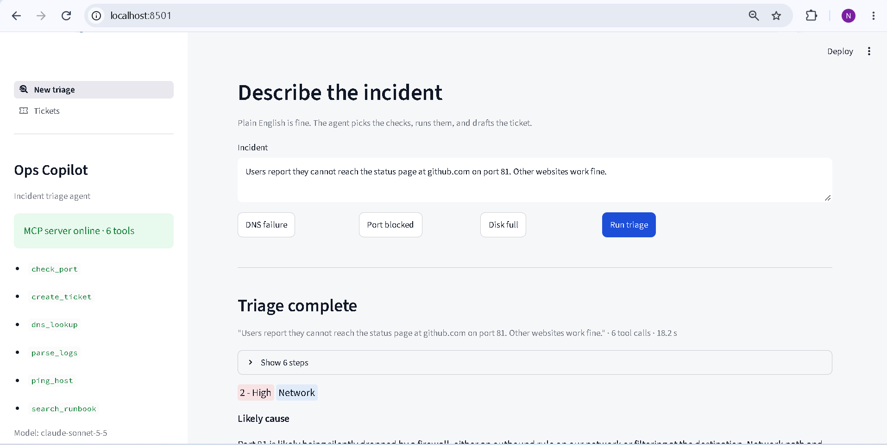
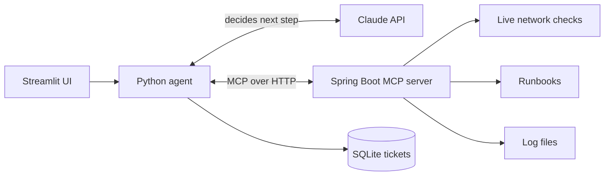
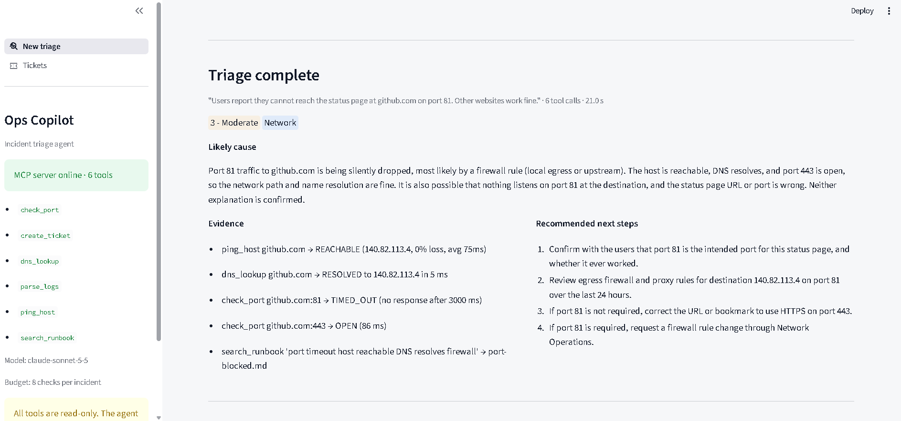
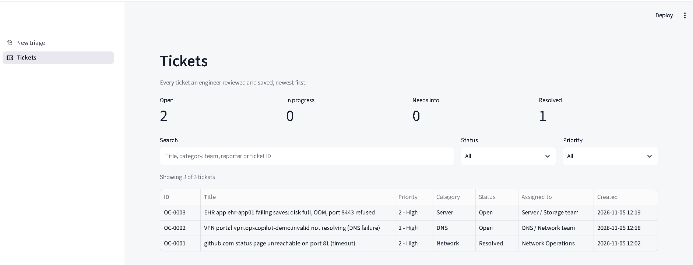
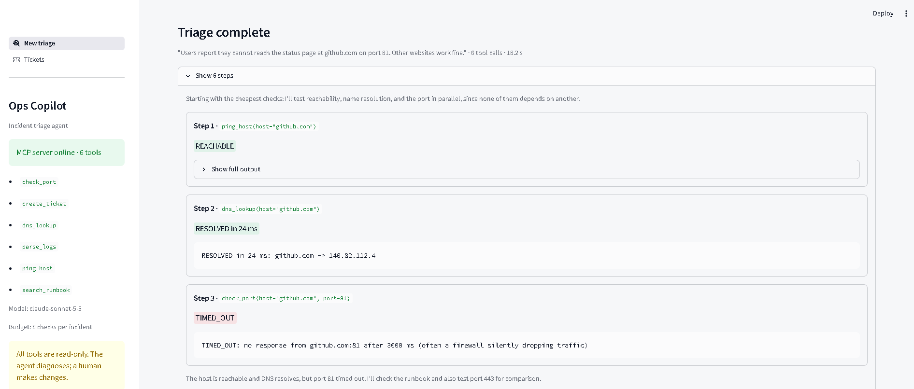
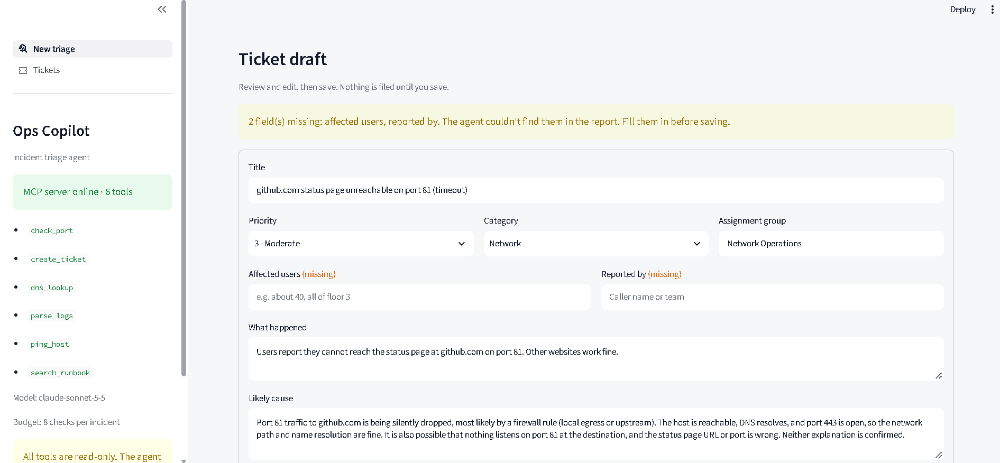
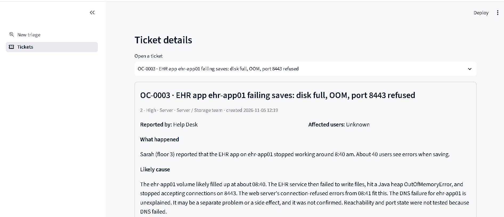
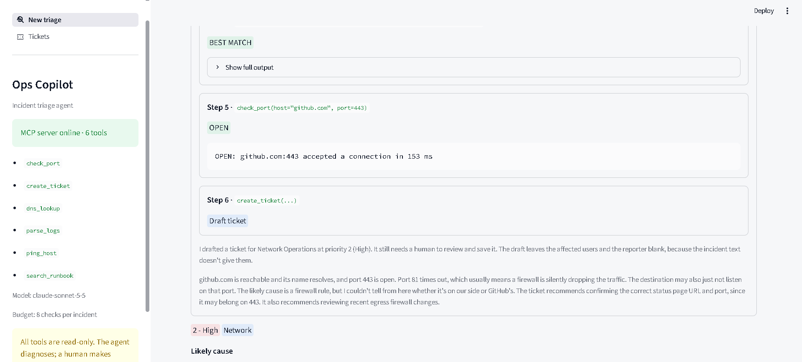
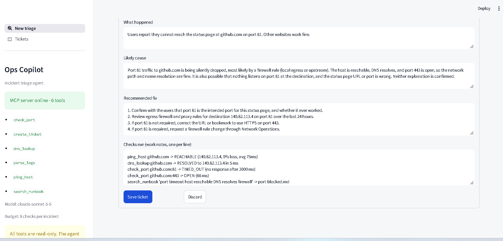
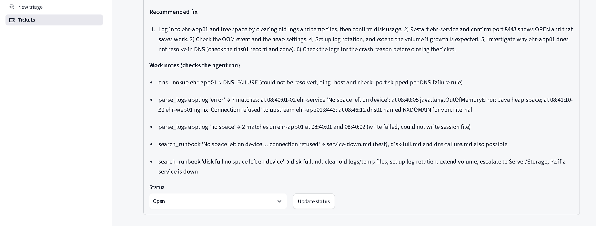

# Ops Copilot

An AI agent that triages IT incidents the way an infrastructure engineer does.
Describe an outage in plain English. The agent runs real diagnostic checks,
reads the team's runbooks and logs, and drafts a ticket for a human to review.

The diagnostic tools are written in **Java (Spring Boot)** and exposed over the
**Model Context Protocol (MCP)**. A **Python** agent connects to them and lets
**Claude** decide which checks to run.



## Why I built it

I've spent years in IT infrastructure, and nearly every incident starts the same way:
ping it, check DNS, check the port, search the runbook, write the ticket.
Ops Copilot automates that first stretch of triage, and it shows its work at every step.

## How it works



1. The engineer describes the incident.
2. Claude picks a tool. The Python agent runs it on the Java MCP server and sends the result back.
3. This repeats, up to 8 diagnostic checks, until Claude has enough evidence.
4. Claude drafts a ticket. The engineer reviews and edits it in plain English, then saves it.
5. Saved tickets appear on a dashboard with status tracking.

### The tools (Java, Spring AI MCP server)

| Tool | What it does |
| --- | --- |
| `ping_host` | Checks whether a host is reachable |
| `dns_lookup` | Resolves a hostname to its IP addresses |
| `check_port` | Tests a TCP port: OPEN, CLOSED or TIMED_OUT |
| `search_runbook` | Finds the best-matching troubleshooting runbook |
| `parse_logs` | Searches log files for matching lines |
| `create_ticket` | Validates and drafts a ticket, and flags missing fields |

## Screenshots

**1. The agent investigates live.** Each check appears as it runs, with a pass or fail badge.


**2. Diagnosis and ticket review.** The likely cause and its evidence, plus a plain-English ticket the engineer can edit.



**3. Tickets dashboard.** Counts, search, filters and status tracking.



<details>
<summary><b>More screenshots</b></summary>

| Agent steps | Ticket review | Dashboard |
| --- | --- | --- |
|  |  |  |
|  |  |  |

</details>

## Safety by design

- **Read-only tools.** The agent diagnoses but never changes anything.
- **A human approves every ticket.** `create_ticket` only drafts. Nothing is saved until an engineer reviews it.
- **No guessing.** If the report doesn't say who's affected or who reported it, the field is flagged as missing.
- **Input validation.** Hostnames are checked against a strict pattern, and `parse_logs` can't read outside the logs folder.
- **Tool budget.** A cap of 8 diagnostic calls per incident stops runaway loops.

## Run it locally

**Requirements:** Java 21+, Python 3.11+, an [Anthropic API key](https://console.anthropic.com/)

**1. Start the MCP server**
```bash
cd mcp-server
./mvnw spring-boot:run        # Windows: .\mvnw.cmd spring-boot:run
```

**2. Start the UI** (in a second terminal)
```bash
cd agent
python -m venv .venv
.venv\Scripts\activate        # macOS/Linux: source .venv/bin/activate
pip install -r requirements.txt
copy .env.example .env        # macOS/Linux: cp .env.example .env, then add your API key
streamlit run app.py
```

Open http://localhost:8501 and try one of the example incidents.

## Project structure

```
ops-copilot/
├── mcp-server/   Spring Boot MCP server with the 6 Java tools
├── agent/        Python agent, Streamlit UI and SQLite ticket store
├── runbooks/     Troubleshooting runbooks the agent searches
├── logs/         Sample log file
└── docs/         Screenshots
```

## About the data

The network checks are real: they run live against the host you name. The runbooks
are written from my own troubleshooting experience. The log file is **synthetic**,
written to match the demo scenarios (disk full, service crash, DNS error). No
employer or patient data is used anywhere in this project.

## Limitations

- The checks run from the machine hosting the server, so results reflect that network's view.
- Runbook search is keyword-based. It works well for a handful of runbooks but isn't semantic.
- Tickets are stored locally in SQLite. There is no ServiceNow integration yet.

## Roadmap

- [ ] Send saved tickets to ServiceNow through its API
- [ ] Semantic runbook search with embeddings
- [ ] More tools: HTTP health checks, SSL certificate expiry, database connectivity
- [ ] An evaluation set that measures diagnosis accuracy

---

Built by **Narendra Reddy** · [LinkedIn]([www.linkedin.com/in/
narendra-reddy9
Vanity URL name
]) · Java, Spring AI, MCP, Python, Claude